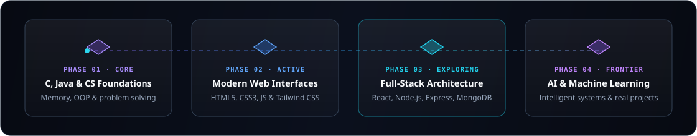

  

  

  
<strong>CSE Student at Daffodil International University</strong> crafting modern, responsive web interfaces while building strong foundations in full-stack engineering and AI/ML.

  

    
    
    
  

  

## About Me

<table>
  <tr>
    <td width="58%" valign="top">
      <h3>Engineering Mind · Daffodil International University</h3>
      
I am <strong>Ridwan Ahamed Shezan</strong>, a Computer Science &amp; Engineering student at <strong>Daffodil International University</strong> with a strong drive for building clean, practical, and visually refined digital products.

      <ul>
        <li><strong>Core Craft:</strong> Designing responsive web interfaces with <strong>HTML5, CSS3, JavaScript, and Tailwind CSS</strong>, grounded in structured and object-oriented problem solving with <strong>C</strong> and <strong>Java</strong>.</li>
        <li><strong>Full-Stack Growth:</strong> Actively learning modern application architecture across <strong>React, Node.js, Express.js, and MongoDB</strong>.</li>
        <li><strong>Research &amp; Curiosity:</strong> Exploring <strong>Artificial Intelligence &amp; Machine Learning</strong> to understand how intelligent systems elevate software.</li>
        <li><strong>Mindset:</strong> Committed to continuous improvement, clean code, and turning concepts into real-world projects.</li>
      </ul>
    </td>
    <td width="42%" align="center" valign="middle">
      
    </td>
  </tr>
</table>

  

## Current Focus & Learning Journey

  

| Focus Area | Current Stage | What I Am Practicing |
| :--- | :--- | :--- |
| **Full-Stack Web Development** | Building & Exploring | Strengthening JavaScript fundamentals and learning React, Node.js, Express.js, and MongoDB |
| **Artificial Intelligence & ML** | Exploring | Studying core concepts, mathematical intuition, and beginner Python workflows |
| **Modern Frontend Architecture** | Active Skill | Crafting accessible layouts, component structure, and responsive Tailwind CSS UI |
| **Real-World Projects** | Ongoing | Translating coursework and self-study into clean, deployable repositories |

  

## Tech Stack

> Honest skill mapping: core technologies I actively build with are separated clearly from technologies I am currently learning and exploring.

<table>
  <tr>
    <th align="left" width="50%">Frontend Development (Core Skills)</th>
    <th align="left" width="50%">Programming Languages (Core Skills)</th>
  </tr>
  <tr>
    <td valign="top">
      

        &nbsp;&nbsp;
        &nbsp;&nbsp;
        &nbsp;&nbsp;
        
      

      <strong>HTML5 · CSS3 · JavaScript · Tailwind CSS</strong> Semantic markup, responsive layouts, interactive DOM logic, and utility-first styling.
    </td>
    <td valign="top">
      

        &nbsp;&nbsp;
        &nbsp;&nbsp;
        
      

      <strong>C · Java · JavaScript</strong> Algorithmic problem solving, object-oriented programming, memory concepts, and browser scripting.
    </td>
  </tr>
  <tr>
    <th align="left">Tools &amp; Platforms (Workflow)</th>
    <th align="left">Currently Exploring &amp; Learning</th>
  </tr>
  <tr>
    <td valign="top">
      

        &nbsp;&nbsp;
        &nbsp;&nbsp;
        &nbsp;&nbsp;
        
      

      <strong>Git · GitHub · VS Code · Vercel</strong> Version control fundamentals, repository hosting, and frontend deployment.
    </td>
    <td valign="top">
      

        &nbsp;&nbsp;
        &nbsp;&nbsp;
        &nbsp;&nbsp;
        &nbsp;&nbsp;
        
      

      <strong>React · Node.js · Express.js · MongoDB · AI/ML</strong> <em>Actively learning and building foundational projects — not yet production-mastered.</em>
    </td>
  </tr>
</table>

  

## Featured Projects

> Note: Project slots marked with `[Placeholder]` are ready for your live GitHub repository and deployment URLs as you publish new work.

<table>
  <tr>
    <td width="50%" valign="top">
      Frontend & Personal Brand
      <h3>Personal Developer Portfolio</h3>
      
Responsive personal portfolio built to present projects, technical foundations, and contact channels with modern UI craft.

      
   

      
<a href="https://github.com/shezan16?tab=repositories" target="_blank" rel="noopener noreferrer"><strong>Placeholder: Link Portfolio Repo</strong></a> · <a href="https://my-protfolio-ip7r.vercel.app/" target="_blank" rel="noopener noreferrer"><strong>Live Portfolio</strong></a>

    </td>
    <td width="50%" valign="top">
      Frontend Development
      <h3>[Placeholder: Interactive Web Interface Project]</h3>
      
Clean, mobile-first web interface focused on layout architecture, interactive DOM state, and responsive Tailwind CSS styling.

      
   

      
<a href="https://github.com/shezan16" target="_blank" rel="noopener noreferrer"><strong>Placeholder: Add Repo URL</strong></a> · <a href="https://my-protfolio-ip7r.vercel.app/" target="_blank" rel="noopener noreferrer"><strong>Placeholder: Add Demo URL</strong></a>

    </td>
  </tr>
  <tr>
    <td width="50%" valign="top">
      Computer Science Core
      <h3>[Placeholder: C Systems & Logic Toolkit]</h3>
      
Structured C programming solutions exploring pointers, memory management, file handling, and foundational data structures.

      
  

      
<a href="https://github.com/shezan16" target="_blank" rel="noopener noreferrer"><strong>Placeholder: Add Repo URL</strong></a> · CLI / Source Only

    </td>
    <td width="50%" valign="top">
      Currently Exploring
      <h3>[Placeholder: Full-Stack & AI/ML Sandbox]</h3>
      
Hands-on learning repository documenting experiments with React components, Express APIs, MongoDB schemas, and AI/ML fundamentals.

      
  

      
<a href="https://github.com/shezan16" target="_blank" rel="noopener noreferrer"><strong>Placeholder: Add Repo URL</strong></a> · In Development

    </td>
  </tr>
</table>

  

## GitHub Analytics Dashboard

<!-- Note: Public Vercel widget instances can occasionally hit shared rate/quota limits. Swap the base domain with your own Vercel deployment if needed. -->

  <table>
    <tr>
      <td align="center" width="54%">
        
      </td>
      <td align="center" width="46%">
        
      </td>
    </tr>
  </table>

  

  

  <h3>GitHub Achievements &amp; Trophies</h3>
  

  

  <h3>Engineering Thought</h3>
  

## Connect With Me

  

    
    
    
    
    
  

  

****
