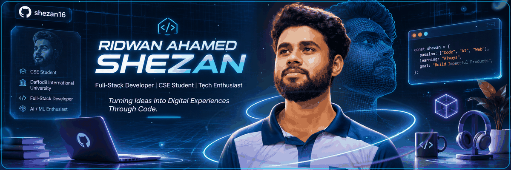

  

    

  
  

  <h2>RIDWAN AHAMED SHEZAN</h2>
  <h3>Full-Stack Developer · CSE Student · Tech Enthusiast</h3>
  
<em>Turning Ideas Into Digital Experiences Through Code.</em>

  
  

---

## ◈ About Me

I'm **Ridwan Ahamed Shezan**, a Computer Science & Engineering student at **Daffodil International University**. I enjoy learning how technology works and turning ideas into practical digital experiences.

- Focused on growing as a **Full-Stack Web Developer**.
- Interested in **Artificial Intelligence, Machine Learning**, and emerging technologies.
- Enjoy building creative projects and learning through hands-on development.
- Always improving my programming fundamentals and problem-solving skills.

> **Build with curiosity. Learn with consistency. Create with purpose.**

## ◈ Focus Areas

<table>
  <tr>
    <td width="50%" valign="top">
      <h3>01 / Full-Stack Development</h3>
      Exploring how frontend interfaces, backend services, and databases work together.
    </td>
    <td width="50%" valign="top">
      <h3>02 / AI & Machine Learning</h3>
      Exploring intelligent applications and practical AI concepts.
    </td>
  </tr>
  <tr>
    <td width="50%" valign="top">
      <h3>03 / Real-World Projects</h3>
      Turning ideas into useful applications and improving them through iteration.
    </td>
    <td width="50%" valign="top">
      <h3>04 / Continuous Learning</h3>
      Strengthening fundamentals and discovering modern development tools.
    </td>
  </tr>
</table>

## ◈ Tech Stack

### Core Skills

  

### Currently Exploring

  

### Tools & Platforms

  

Core Skills represent my current working knowledge. Currently Exploring lists learning areas, not advanced proficiency claims.

## ◈ GitHub Analytics

  
  

  

## ◈ Contribution Graph

  

## ◈ GitHub Trophies

  

## ◈ Featured Projects

<table>
  <tr>
    <td width="50%" valign="top">
      <h3>Weather Data Analysis System</h3>
      A project for managing and analyzing weather records, with a web interface and backend API.
        
      <strong>Technologies:</strong> C, HTML, CSS, JavaScript, Node.js, Express.js
        
      <a href="https://github.com/shezan16">Explore my repositories ↗</a>
    </td>
    <td width="50%" valign="top">
      <h3>More projects in progress</h3>
      I'm continuing to build and document practical projects as I learn new technologies.
        
      <strong>Project links:</strong> To be added when repositories are published.
        
      <a href="https://github.com/shezan16?tab=repositories">View repositories ↗</a>
    </td>
  </tr>
</table>

## ◈ Learning Roadmap

- [ ] Strengthen modern JavaScript and frontend fundamentals.
- [ ] Build and deploy complete full-stack applications.
- [ ] Learn React and component-based UI development.
- [ ] Deepen backend, API, and database knowledge.
- [ ] Explore practical AI and Machine Learning workflows.
- [ ] Improve testing, documentation, and code quality.

## ◈ Connect

  
  
  
  
  

---

  
    
  <strong>CODE · CREATE · INNOVATE</strong>
   
  Designed by Ridwan Ahamed Shezan · shezan16

